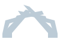
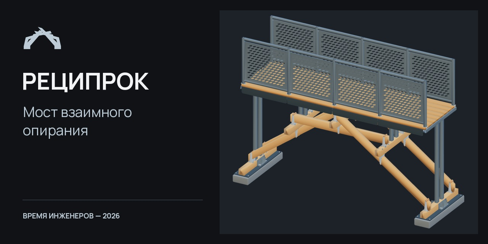
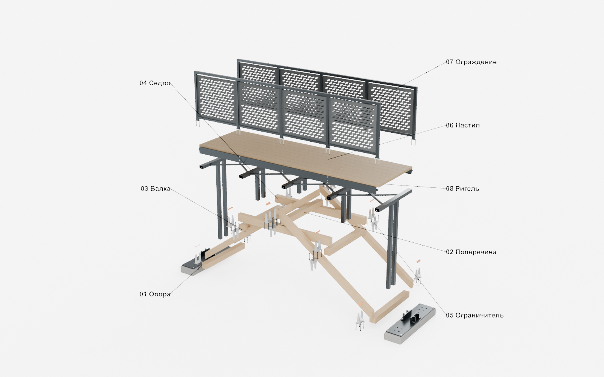

#  РЕЦИПРОК

**Цифровая концепция временного пешеходного моста для кейс-турнира «Время инженеров — 2026».**

[Интерактивный сайт](https://mishaturchin2002-netizen.github.io/reciprok/) · [Презентация PDF](assets/presentation.pdf) · [Инженерная записка](assets/research.md)

## Принцип

Продольные балки и поперечины поочерёдно опираются друг на друга. В V6 стальные сёдла задают контактные поверхности, ограничители контролируют раскрытие, а Х-связи под настилом сопротивляются перекосу в плане. Исторический источник — [музейная реконструкция Museo Leonardiano по листу 69r Codex Atlanticus](https://museoleonardiano.it/en/opera/rapid-construction-bridge/).

## Модель и исследование

- 4,50 м между осями опор, 1,20 м полезная ширина прохода.
- 993,67 кг по CAD без береговых опор, 6 продольных балок, 5 поперечин и 18 сёдел.
- V3 — исходная компоновка. V4 — проверка контактов. V5 — переработка креплений. V6 — уменьшение высоты и добавление пространственных связей.
- В боковом расчётном сценарии перемещение V6 уменьшилось с 89,8 до 29,5 мм относительно V5. Местная реакция удержания выросла с 4,65 до 12,65 кН. Жёсткость Х-связей в модели условная.
- Совмещённый сценарий выявил превышение принятого критерия для балки. Допустимая эксплуатационная нагрузка не установлена.

[FreeCAD](assets/Reciprok_V6.FCStd) · [STEP](assets/Reciprok_V6.step) · [GLB](assets/reciprok.glb) · [План](assets/drawing-plan.webp) · [Продольный вид](assets/drawing-side.webp) · [Сравнение ревизий CSV](assets/research.csv)

## Репозиторий

`assets/` — модели, чертежи, анимации и презентация. `SOURCE/` — экспорт модели. `vendor/` — Three.js и Draco. Сайт статический, для локального просмотра из корня запустите `python -m http.server 8000`. Модель загружается по запросу. При сбое WebGL доступен статический вид.

## English summary

Reciprok is a digital concept for a modular pedestrian crossing inspired by Leonardo da Vinci’s reciprocal bridge. V6 combines a timber load-bearing frame with steel seats, deck and guardrail assemblies, and X-bracing. The repository includes CAD models, assembly media and selected research results. An allowable service load has yet to be established.
